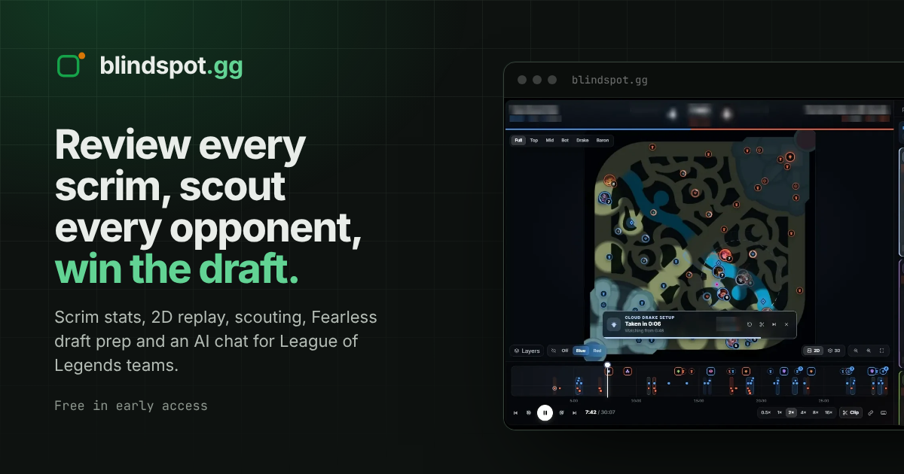
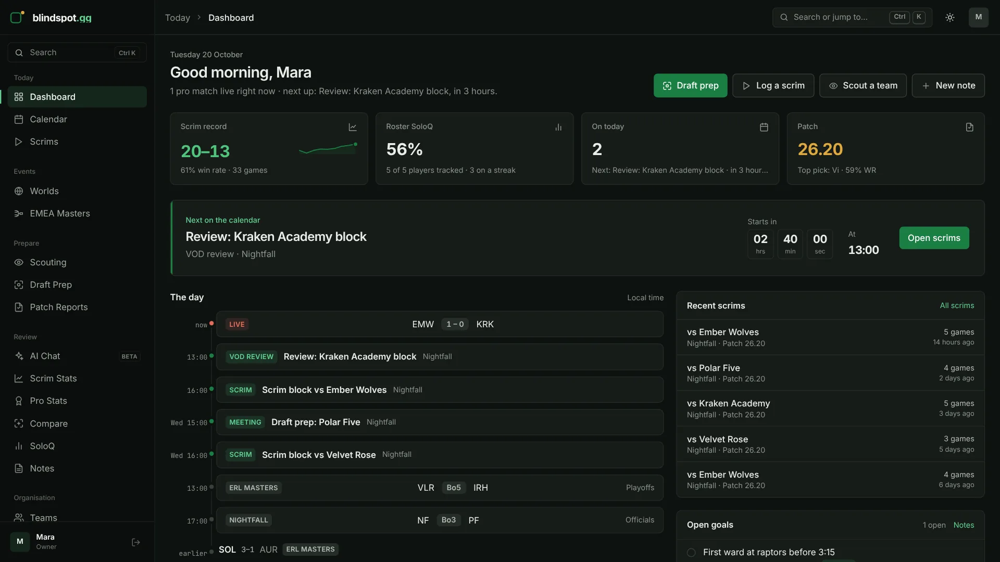
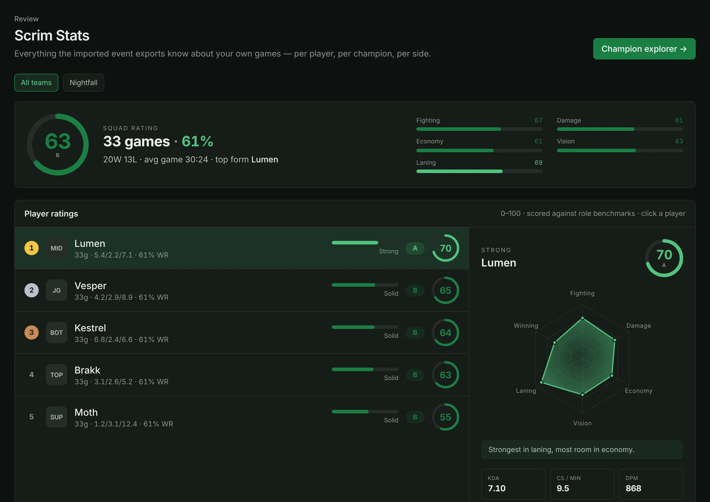
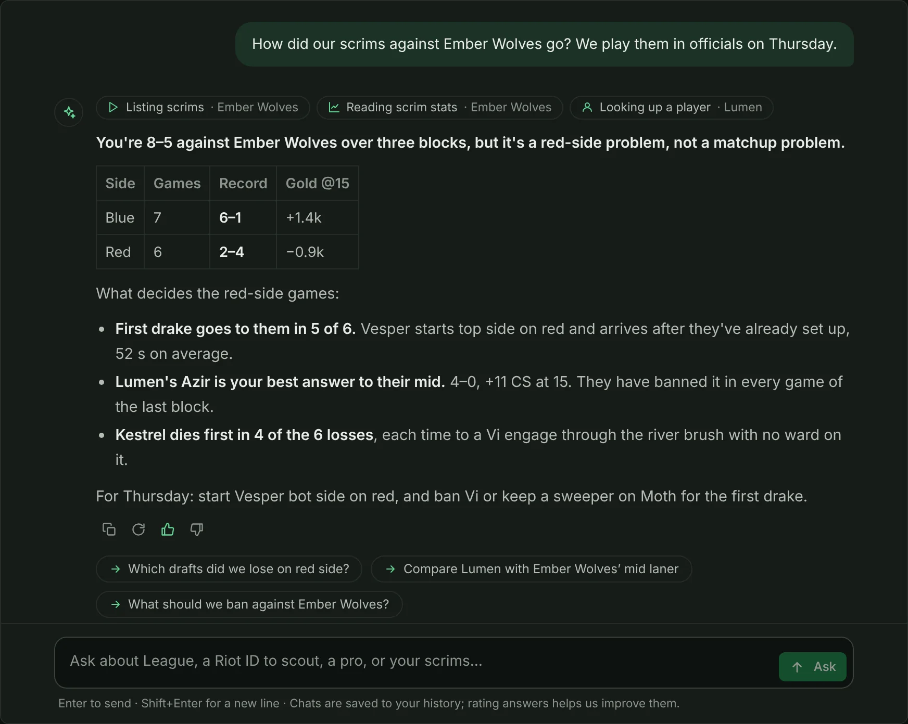
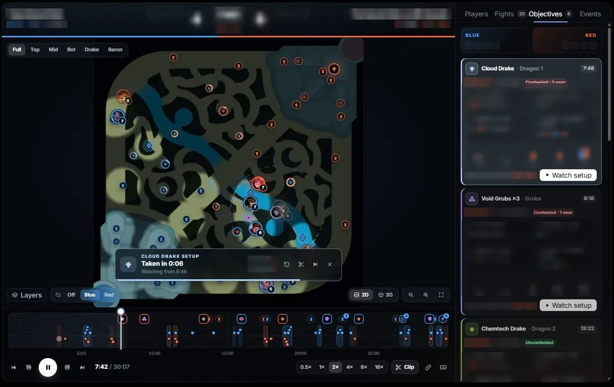
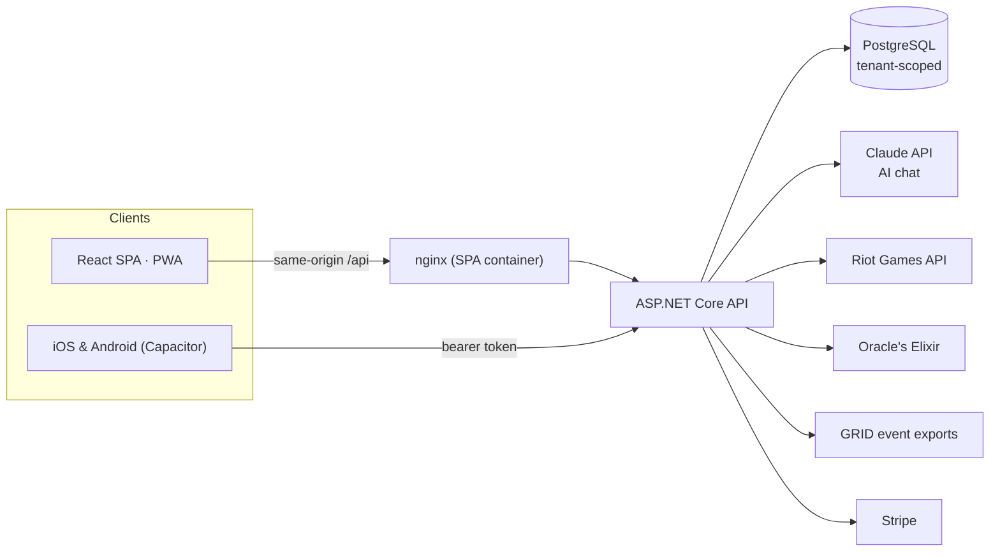

# Blindspot.gg — case study

**A SaaS coaching platform for competitive League of Legends teams — designed, built and run by me, end to end.**

🌐 **Live:** [blindspot-gg.com](https://blindspot-gg.com) · 🛠️ **Stack:** React 19 · TypeScript · ASP.NET Core · PostgreSQL · Claude API · Docker

> The source code is private (it is a commercial product). This repository documents what the product does and how it is built. Screenshots use demo data; the 2D replay is a real game with names and numbers blurred.

---

## The problem

Amateur and semi-pro esports teams practise in *scrims* — private matches against other teams — and prepare for officials by scouting opponents and planning drafts. Most staff do this across spreadsheets, VOD tools, stats sites and a dozen browser tabs, so the review starts from guesswork instead of data.

## The product

One workspace for the whole roster and coaching staff:

- **Scrim tracking & stats** — import game event exports (or let GRID sync them every 20 minutes) and every player gets a 0–100 rating against role benchmarks, with champion, side and opponent splits across the season.
- **2D replay & game review** — fights on a timeline, objective setups, clips, and a model trained on pro games that rates the calls made in a scrim.
- **Opponent scouting & pro stats** — form, champion pools, bans and tendencies from pro match data (Oracle's Elixir), with patch windows and league tiers.
- **Live draft rooms** — Fearless, Ironman and First Selection series from a shared link, with a timer and a stream overlay for OBS.
- **SoloQ tracking** — the roster's ranked climb, LP history, champion pools and session recaps via the Riot Games API.
- **AI chat** — ask questions in plain language and get answers looked up from the team's own scrims, roster and notes, and from live League data.
- **Team operations** — calendar, coaching notes with goals, roles and permissions, Discord alerts and Stripe billing.

| | |
|---|---|
|  |  |
| **Dashboard** — the day at a glance | **Scrim stats** — players rated against role benchmarks |
|  |  |
| **AI chat** — answers from the team's own data | **2D replay** — objective setups and fights |

## My role

Everything from product decisions to production: UX and visual design, the React front end, the .NET API and data model, data pipelines, the AI integration, the mobile builds, infrastructure, CI, and the marketing site.

## Architecture

Deployed as Docker images on Render (Postgres, API, and an nginx container that serves the SPA and proxies the API), behind Cloudflare.

## Engineering highlights

**AI chat that can't make up your data.** The assistant runs on Claude, but it cannot run queries of its own: the API gives it a fixed set of read-only lookups (the org's scrim stats, a player's profile, notes the user is allowed to read, SoloQ by Riot ID, pro stats, matchups and builds), each scoped to the caller's organisation. Answers stream back as NDJSON with a Stop button, every lookup is listed above the answer, and chats are saved with ratings, regeneration and suggested follow-up questions. An owner dashboard tracks questions, failures, answer time and estimated cost.

**Multi-tenant by construction.** Teams share one database, so isolation is held up in layers: EF Core query filters on every organisation-owned table, raw SQL checked by a test that reads the source, ids from request bodies validated against the caller's organisation, the session re-checked against the database on every request, and role-based write permissions. Each layer has a test that fails the build if it is weakened.

**Data pipelines that run themselves.** Background importers pull Oracle's Elixir pro data and GRID scrim exports on a schedule (the GRID key is stored AES-GCM encrypted), and SoloQ syncs the newest 200 ranked games per player. Each import records what it handled, so a sync never double-imports.

**A frontend built for daily use.** React 19 with TanStack Query, every screen code-split, a ⌘K command palette across pages, teams, players, scrims and notes, two-key navigation shortcuts, light and dark themes with AA-contrast tokens, and an offline-aware PWA. Every list goes through one loading / error / empty / content component, so failures show up as errors with a retry, never as a silently empty page.

**Fast for search engines and first visits.** The public pages are prerendered at build time with their own titles, structured data and link previews, then taken over by the app.

**Mobile from the same codebase.** The same React app ships as iOS and Android apps through Capacitor, with a GitHub Actions workflow that builds the Android APK.

**Quality and developer experience.** xUnit tests for the API's logic, 330+ Vitest unit tests on the frontend, and type-checking plus a production build on every pull request. A demo mode serves the whole app from an in-memory, seeded API, so frontend work needs neither the .NET SDK nor a database.

**Production hardening.** A strict Content-Security-Policy and security headers, an HttpOnly session cookie, JSON error responses while the API restarts, and sign-in sessions that survive a deploy or a dropped connection instead of logging users out.

## By the numbers

| | |
|---|---|
| Started | June 2026 |
| Commits / pull requests | 210+ / 46 |
| Frontend | ~55k lines of TypeScript, 25+ screens |
| Backend | ~30k lines of C#, 220+ API endpoints |
| Platforms | Web (PWA), iOS, Android |

## Tech stack

| Area | Tools |
|---|---|
| Frontend | React 19, TypeScript, Vite, Tailwind CSS 4, TanStack Query, React Router |
| Backend | ASP.NET Core minimal APIs, Entity Framework Core, PostgreSQL, JWT / cookie auth |
| AI | Claude API (tool use, streaming) |
| Mobile | Capacitor (iOS, Android) |
| Infrastructure | Docker, nginx, Render, Cloudflare, GitHub Actions |
| Integrations | Riot Games API, Oracle's Elixir, GRID, Stripe, Discord webhooks |

---

### Want something like this built for you?

I take on freelance work: full-stack web apps, React frontends, .NET APIs and AI features.
**[andrej.kukuruzovic@gmail.com](mailto:andrej.kukuruzovic@gmail.com)** · **[X @HumnamDev](https://x.com/HumnamDev)** · [More about me](https://github.com/AndrejDev10)
